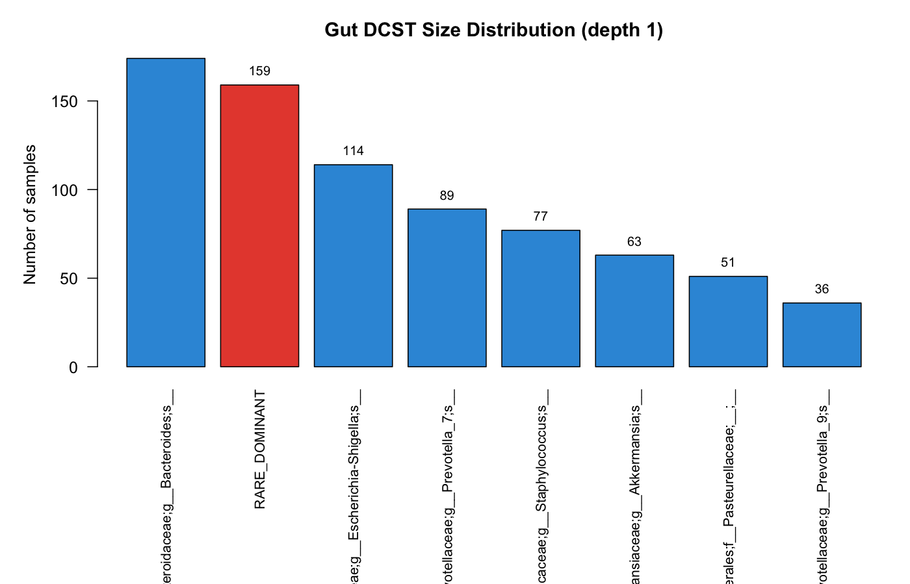

<!-- README.md is generated from README.Rmd. Please edit that file -->

```{r setup, include=FALSE}
knitr::opts_chunk$set(collapse = TRUE, comment = "#>")
```

<!-- badges: start -->
[](https://github.com/pgajer/linf/actions/workflows/R-CMD-check.yaml)
[](https://doi.org/10.48550/arXiv.2503.21543)
<!-- badges: end -->

# linf: group samples by their most abundant features

**linf** works with nonnegative measurements, such as microbial counts or
proportions. Supply a numeric matrix with **samples in rows and features in
columns**. A feature is a measured quantity, such as the abundance of a type
of bacterium.

The package can rescale each sample by its largest value, group samples by
which features are most abundant, and divide those groups into smaller groups.
It can also assign new samples to groups you have already defined. The groups
are called *dominant community state types* (dCSTs) in the package and methods
paper.

## A first example

After [installation](#installation), try this example. `n0 = 4` means a group
must initially contain at least four samples to be kept. `set.seed(1)` makes
the randomly generated example data repeatable.

```{r first-result, message=FALSE}
library(linf)
set.seed(1)
counts <- matrix(rpois(30, 5), nrow = 10,
                 dimnames = list(paste0("s", 1:10), c("A", "B", "C")))
M <- normalize.linf(counts)
dominant <- linf.dominant.features(M)
fit <- linf.csts(M, n0 = 4, low.freq.policy = "absorb")
```

```{r first-result-table, echo=FALSE}
knitr::kable(data.frame(
  Feature = colnames(M),
  `Samples before reassignment` = as.integer(table(factor(dominant$id, levels = colnames(M)))),
  `Samples after reassignment` = as.integer(table(factor(fit$lineage.id, levels = colnames(M)))),
  check.names = FALSE
))
```

Each sample is first assigned to its largest feature. When largest values are
equal, the first column is used. This gives four samples to A, four to B, and
two to C. Groups A and B meet the minimum size of four. Group C is too small,
so each of its samples is reassigned to A or B, whichever has the larger value
in that sample. Here, both go to A: the final groups contain six and four
samples. The option `"absorb"` selects this reassignment rule. A was not the
largest feature in the two reassigned samples; C was.

`M` contains the rescaled values. Each sample's largest value is now one,
and zeros stay zero. Use `M` directly if you only need rescaling, without groups.

## Group by leading features, regardless of their order

Use `linf.udcsts()` when samples should belong to the same group if they have
the same leading features. For example, A followed by B and B followed by A
both count towards one `{A, B}` group. The minimum group size is checked after
combining them:

```{r unordered-result}
U <- rbind(c(A = 9, B = 5, C = 1), c(A = 8, B = 4, C = 1),
           c(A = 4, B = 9, C = 1), c(A = 3, B = 8, C = 1),
           c(A = 1, B = 3, C = 9))
unordered <- linf.udcsts(U, level = 2, n0 = 3, low.freq.policy = "filter")
unordered$frequency.table
U[unordered$keep, , drop = FALSE]
```

The four samples led by A and B remain. The single sample led by B and C is
excluded because its group is smaller than three. It is not reassigned.

The result includes:

- `ID`: the original column numbers of the features in each group; `1,2` means
  A and B here.
- `freq`: the number of samples originally in that group, before any
  reassignment or exclusion.
- `cumm.pct`: the percentage of all input samples in this group and groups at
  least as large. Groups with equal counts get the same percentage. Here the
  four A/B samples account for 80% of the five input samples.
- `pure.id`: the original group of each sample, kept even if it is later
  reassigned or excluded.

The `"filter"` option excludes samples from small groups, as above. The
`"pure"` option keeps them but marks them as rare. The `"absorb"` option
reassigns them to the kept group whose features have the largest combined
abundance in that sample. This differs from `linf.csts()`, which uses one
feature at a time and restricts each subdivision to its current group.
See `?linf.udcsts` for details.

## Connect groups in a network

`linf.udcst.graph()` connects groups defined by their two leading features.
By default, pairs such as `{A, B}` and `{A, C}` are linked only if both occur
among samples whose three leading features are `{A, B, C}`. Sharing A alone
is not enough.

The result records the supporting sample counts, measures of how often each
pair and its three-feature group occur together, and which group each sample
belongs to. Counts use all input samples, even if you keep only some pairs in
the network. It also reports triangles supported by the same three-feature
group. Every link has length one; a larger sample count does not shorten it.
Unconnected pairs and separate parts of the network are kept.
See `?linf.udcst.graph` for details.

## Installation

Install the released package from CRAN:

```r
install.packages("linf")
```

`linf.udcsts()` and `linf.udcst.graph()` require **linf 0.4.0 or later**.
Check your installed version with `packageVersion("linf")`. Version 0.4.0
includes four guides, called *vignettes* in R. Open the function and example-data
guides with:

```r
help("linf", package = "linf")
vignette("function-guide", package = "linf")
vignette("example-datasets", package = "linf")
```

The [published website](https://pgajer.github.io/linf/) is updated separately
and may describe an older version. Use the installed help for the version you run.

## Choose the next step

- **Prepare the data:** `filter.asv()` removes samples with too few total counts
  and features that occur in too few samples. `normalize.linf()` divides each
  sample's values by its largest value. Samples whose largest value is at or
  below the chosen cutoff (`tol`) are left unchanged, including all-zero samples.
- **Form groups:** `linf.dominant.features()` identifies each sample's largest
  feature. `linf.csts()` forms groups with a minimum size;
  `refine.linf.csts()` divides selected groups into smaller groups using their
  next leading features.
- **Inspect results:** `summary()` counts assigned, rare and unassigned samples.
  `linf.landmarks()` selects representative samples from the observed data using
  a chosen feature's value, for example the sample closest to its mean or median.
  It returns actual samples, not averages of their measurements.
- **Assign new samples:** `transfer.dcsts()` uses the groups defined by an earlier
  call to `linf.csts()`, without changing their definitions.

Scaling by the largest value is called *L-infinity normalization*. The values
are not required to sum to one, and no logarithms are taken. Zeros stay zero.
Grouping results depend on which features you include, the minimum group size,
how small groups are handled, and how choices between equal values are made.
Adding more levels gives finer groups, but does not necessarily make them more
useful. The [function guide source](vignettes/function-guide.Rmd) explains these
choices with runnable examples.

## Gut microbiome example

The figure below shows the first level of grouping for 766 gut microbiome
samples provided with the package, from the American Gut Project (AGP).
Filtering leaves 763 samples and 307 microbial features. Groups initially
containing fewer than 30 samples are too small to keep. Their samples are
reassigned to the kept groups, using the largest value among the remaining
defining features in each sample. The figure shows the resulting groups,
without a separate rare-sample category.

This subset includes every available sample assigned to four selected uncommon
groups. The remaining places were filled by random selection from other
eligible samples, using seed 42. Selection did not use participants' recorded
traits. Because groups had different chances of being selected, do not use the
observed trait frequencies, differences between groups, or statistical test
results to draw conclusions about the broader population. These data are
provided to demonstrate how to use the package.

### Number of samples in each group



The 763 samples are assigned to seven groups. The largest are *Bacteroides*
(239 samples), *Escherichia-Shigella* (134), and *Staphylococcus* (102).
In total, 159 samples were reassigned from groups below the minimum size.

See `vignette("linf-intro", package = "linf")` for a reproducible example
using these data.

## Guides and worked examples

Version 0.4.0 includes four installed guides. The first two links below open
their source files on GitHub; the R commands open the formatted guides locally.

- [Finding your way around linf](vignettes/function-guide.Rmd)
  — choose functions, arrange your data, handle small groups, select
  representative samples, and assign new samples to existing groups.
  Open with `vignette("function-guide", package = "linf")`.
- [Example datasets and reproducible workflows](vignettes/example-datasets.Rmd)
  — choose among the five example datasets, match sample information to data
  rows, and try defining groups with one set of samples and assigning another
  set to them. Open with `vignette("example-datasets", package = "linf")`.
- [Gut microbiome example](https://pgajer.github.io/linf/articles/linf-intro.html)
  — rescale the data, form groups, and explore the selected AGP gut samples.
- [Vaginal microbiome example](https://pgajer.github.io/linf/articles/linf-vaginal.html)
  — form groups and compare them with Valencia classifier labels. The samples
  come from the same source dataset used to develop the classifier; agreement
  here does not establish performance on independent samples.

The [interactive 3D visualization example](https://pgajer.github.io/linf/articles/valencia-hypercube-embedding.html)
is available on the website only.

```r
browseVignettes("linf")
```

## Citation

If you use this package, please cite:

> Gajer, P. & Ravel, J. (2025). A New Approach to Compositional Data Analysis
> using L∞-normalization with Applications to Vaginal Microbiome. *arXiv
> preprint arXiv:2503.21543* [stat.CO].
> doi: [10.48550/arXiv.2503.21543](https://doi.org/10.48550/arXiv.2503.21543)

**BibTeX**
```bibtex
@article{gajer2025linf,
  title   = {A New Approach to Compositional Data Analysis using
             {$L^{\infty}$}-normalization with Applications to
             Vaginal Microbiome},
  author  = {Gajer, Pawel and Ravel, Jacques},
  year    = {2025},
  eprint  = {2503.21543},
  archivePrefix = {arXiv},
  primaryClass  = {stat.CO},
  journal = {arXiv preprint arXiv:2503.21543},
  doi     = {10.48550/arXiv.2503.21543},
  url     = {https://arxiv.org/abs/2503.21543}
}
```

## License

MIT © 2025 Pawel Gajer. See [LICENSE](LICENSE).
Sources and reuse conditions for the example data are recorded in
[the data-source notes](https://github.com/pgajer/linf/blob/main/inst/DATA_PROVENANCE.md).
